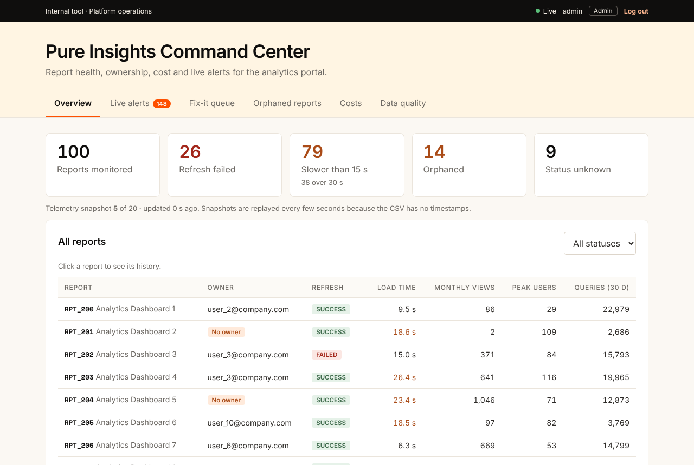
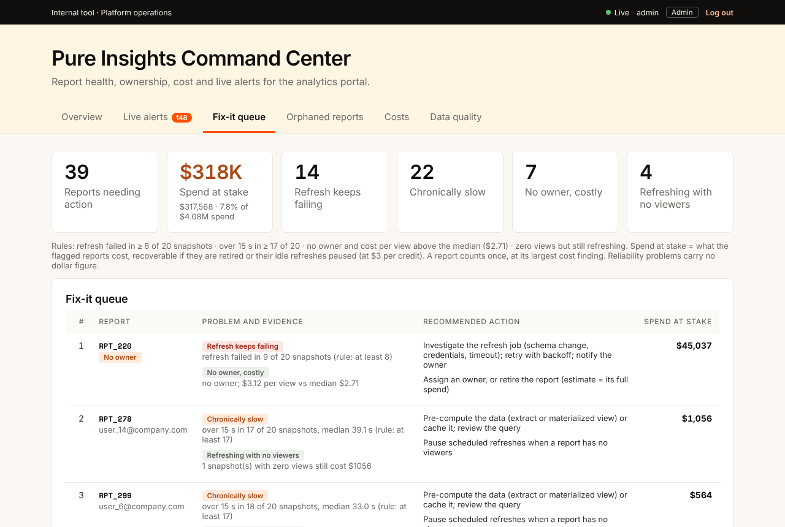

# Pure Insights Command Center

**Everpure FY27 Internship Assessment · Case Study 3: Technical Data AI Validation – Monetization**
Aslesha Mohanty · Submitted 14 October 2026

**Demo video:** [Watch the 1:40 demo (silent walkthrough)](https://drive.google.com/file/d/1gLMSe_OnrQ4u5ZVGBeWeYpVcfJlapIPT/view?usp=sharing)  ·  **Full write-up:** [docs/WRITEUP.md](docs/WRITEUP.md)

Everpure moved its internal reporting from Tableau Server to a custom portal and lost the admin views Tableau gave for free. Nobody could easily see which reports were failing, which were slow, who owned them or what they cost. I built the missing command center: a live admin dashboard with role-based access, real-time alerts, Snowflake cost attribution, and a fix-it queue that turns all of that into a ranked list of actions.

Because the role is about validation, I treated every number as something to prove. The data was checked before use, totals reconcile, the SQL and the API compute the same answers independently, and one feature I designed was tested, failed, and deliberately left out.

## Results at a glance

| | |
|---|---|
| **~$318K spend at stake** | 39 of 100 reports need action. Up to $317,568 (7.8% of $4.08M spend, at $3/credit) could be recovered if the flagged reports are retired or their idle refreshes paused |
| **14 orphaned reports** | No owner, yet they account for 14.4% of all spend. Admins can assign an owner from the dashboard, and every change is audited |
| **75% of loads over 15 s** | With refresh failures, 82% of rows breach the brief's alert rule. So alerting fires when a problem starts, not on every slow row: 1,109 alerts instead of 1,636 (32% fewer), with no breach missed |
| **SQL = API** | Snowflake SQL and the Node.js API independently find the same most expensive report: RPT_223 at $4.99 per view |
| **61 automated checks** | Data reconciliation, RBAC, alerts, fix-it invariants and SQL, run on every push by GitHub Actions |
| **1 feature not shipped** | An owner-suggestion idea was backtested at 3% accuracy, worse than random (7%), so I left it out |



<details>
<summary>Fix-it queue (39 reports ranked with evidence, an action and the spend at stake)</summary>



</details>

---

## 1. How to start

You need Node.js 20+, Python 3 and `pip3 install duckdb` (DuckDB is only used to test the SQL).

```bash
npm run setup          # install server and dashboard packages
npm start              # API + WebSocket on http://localhost:4000
npm run dev:client     # dashboard on http://localhost:5173 (second terminal)
```

Open **http://localhost:5173** and sign in:

| Login | Password | What you will see |
|---|---|---|
| `admin` | `admin123` | Everything: live health, alerts, fix-it queue, orphaned reports (with owner assignment), costs, data quality |
| `owner` | `owner123` | Only the 9 reports owned by user_9@company.com: their alerts, fix-it items and costs |
| `viewer` | `viewer123` | Health overview only, without owner emails, costs or alerts |

Other commands:

```bash
npm test               # every check (61 tests + reconciliation)
npm run reset-state    # forget owner changes made in the dashboard
npm run alert-noise    # alert volume under different alerting policies
```

---

## 2. Deliverables

| The brief asked for | Where to find it |
|---|---|
| **1. Runnable full-stack codebase** (React frontend, Node.js backend) | `client/` (React + Vite) and `server/` (Node.js + Express). Start with section 1 |
| **2. REST API & WebSocket technical specification** | [`docs/API_SPEC.md`](docs/API_SPEC.md) |
| **3. Snowflake cloud cost allocation SQL script suite** | [`sql/`](sql/): `01_ddl.sql` to `05_checks.sql`, run locally with `npm run test:sql` |
| Task 1: dashboard with RBAC, system health, orphaned reports | Overview, Orphaned reports and Data quality tabs; `server/server.js`, `server/auth.js` |
| Task 2: real-time alerts when load time exceeds 15 s or a refresh fails | Live alerts tab; `server/alerts/`, `server/ws.js`, `client/src/useLive.js` |
| Task 3: credits per report and unit cost per active user view | Costs tab; `sql/04_cost_attribution.sql` |
| Data defects found, cleaned and documented | `clean.js` → `data/cleaning_log.csv`; [`docs/DATA_QUALITY.md`](docs/DATA_QUALITY.md) |

### Other documents

| Document | What it covers |
|---|---|
| [`docs/WRITEUP.md`](docs/WRITEUP.md) | The full story: how I worked through the data, each task, going beyond the brief, and what I found |
| [`docs/API_SPEC.md`](docs/API_SPEC.md) | Every endpoint, permissions per role, error codes, WebSocket messages, reconnect behaviour |
| [`docs/ARCHITECTURE.md`](docs/ARCHITECTURE.md) | How the parts fit together, design decisions and trade-offs, production path |
| [`docs/DATA_QUALITY.md`](docs/DATA_QUALITY.md) | Every data rule and result, reconciliation, alert noise analysis, fix-it validation, the owner backtest |

---

## 3. Tech stack

| Layer | Choice | Why |
|---|---|---|
| Frontend | React 19 + Vite | Required by the brief; Vite gives fast reloads and a simple build |
| Backend | Node.js 20 + Express 5 | Required by the brief; small, readable REST API |
| Real-time | `ws` (WebSocket) | The brief allowed SSE or WebSocket; WebSocket leaves room for two-way actions like acknowledging alerts |
| Auth | JSON Web Tokens + salted scrypt password hashes | Stateless sessions; no plain-text passwords |
| Data cleaning | Node.js + `csv-parse` | Same language as the server, so the API serves exactly what was validated |
| SQL | Snowflake SQL, tested in DuckDB | Snowflake is the target; DuckDB runs the same MERGE, QUALIFY and window functions locally |
| Fonts and styling | Inter + Space Mono (bundled), plain CSS | Colours taken from Everpure's own site; no runtime calls to third parties |
| CI | GitHub Actions | Runs every check and builds the dashboard on each push |

---

## 4. How I tested it

`npm test` runs everything and stops with an error if anything fails. GitHub Actions runs it on every push.

| Suite | Checks | What it proves |
|---|---|---|
| Data cleaning | reconciliation | Nothing was lost or invented while cleaning |
| Fix-it queue | 6 + sensitivity | Every item has evidence; no double counting; spend at stake never exceeds spend; counts reproducible by hand |
| API, RBAC and security | 31 | 401 and 403 in the right places; viewers never get emails or costs; owners see only their reports; only admins reassign owners; security headers; forged tokens rejected; login rate limiting |
| Real-time alerts | 14 | The system is live; viewers and fake tokens are refused; owners get only their alerts; 15 s and 30 s thresholds correct; no repeat alerts during an ongoing problem; missed alerts can be fetched |
| SQL | 10 | Every row loaded; no duplicates after a re-run; quarantine reconciles; allocated credits equal the bill; SQL agrees with the API and with the cleaning script |

I also clicked through the dashboard as each role in a real browser, including what happens when the server restarts or a session expires.

---

## 5. Project structure

```
clean.js                 data validation and cleaning → data/clean/, data/cleaning_log.csv
server/
  server.js              REST API, live state (snapshot clock + ownership register), WebSocket
  auth.js                login, password hashing, 401/403 middleware
  ws.js                  WebSocket: token check, role-filtered alerts, heartbeat
  fixit.js               fix-it queue rules, evidence, actions, spend at stake
  alerts/engine.js       alert rules and "alert when a problem starts"
  alerts/replay.js       replays the 20 snapshots as live telemetry
client/src/              React dashboard (App, pages/, useLive.js for the WebSocket)
sql/                     Snowflake SQL suite, 01_ddl.sql to 05_checks.sql
scripts/                 test-all.js, run_sql.py, validate-fixit.js, backtest-owner.js,
                         alert-noise.js, reset-state.js
test-rbac.js, test-alerts.js   API and WebSocket tests
docs/                    write-up, API spec, architecture, data quality, screenshots
first.js, load.js, validate.js, watch-alert.js   my first learning scripts, kept for reference
```

---

## 6. What I would do next

- **Real telemetry.** Have the portal send load times and refresh results to a queue, instead of replaying a CSV.
- **Single sign-on** instead of demo logins, with ownership and its audit log in a database.
- **Query tags** on every portal query, so Snowflake attributes cost to reports exactly.
- **An alert lifecycle**: acknowledge, resolve, time to acknowledge, and routing critical alerts to Slack or email.
- **Cost-overrun alerts** once each report has an agreed budget (for example at 80% and 100% of budget).
- **Root causes for the fix-it queue** by linking each finding to its refresh error logs.
- **Anomaly detection** once there is real history, validated against the current rules as a baseline.
- **Usability**: search and sorting on tables, alert filters, trend charts, a people picker for owners.

---

## 7. Assumptions and limitations

### Assumptions

| Assumption | Why | Where to change it |
|---|---|---|
| Every 100 CSV rows are one snapshot in time (20 snapshots) | The CSV has no timestamps; the rows repeat RPT_200 to RPT_299 twenty times in order | `clean.js`, `sql/02_load.sql` |
| Roles are admin (platform team), owner (report author) and viewer (report consumer), with least-privilege permissions | The brief requires RBAC but does not define roles | `server/auth.js`, `server/server.js` |
| The ownership register starts from the owner in the latest snapshot; only admins change it | Owners change between snapshots in the data; responsibility should change only by a deliberate, audited action | `server/server.js` |
| "Active users" in defect 4 means monthly active views | The brief does not define it; peak users is shown alongside | `clean.js`, `sql/04_cost_attribution.sql` |
| $3.00 per Snowflake credit | The real price depends on Everpure's contract | `server/server.js`, `REPORTING.COST_CONFIG` |
| 10% warehouse idle time in the simulated billing log | Only used to demonstrate idle-time allocation | `REPORTING.COST_CONFIG` |
| A new snapshot every 3 seconds | Simulates a live feed | `REPLAY_MS` environment variable |
| Fix-it thresholds: 8 of 20 failed refreshes, 17 of 20 slow loads | Clearly worse than typical (most reports fail 6 of 20); sensitivity shown in `docs/DATA_QUALITY.md` | `server/fixit.js` |

The dataset I received is named differently from the brief (`Case_Study_3_Technical_Data_AI_Validation_Intern_-_Monetization.csv` instead of `Case_Study_3_Pure_Insights_Monitoring.csv`). I used the received file, saved as `data/raw/reports.csv`.

### Limitations, and how I handled them

| Limitation | What I did | In production |
|---|---|---|
| The data is a fixed CSV, so the live feed repeats every 60 seconds | Kept it. Generating extra data would mean inventing it | A real event stream |
| No Snowflake account | SQL written in Snowflake syntax and tested in DuckDB | Run against Snowflake |
| Demo logins | Passwords stored as salted hashes; the server refuses to start in production without a real `JWT_SECRET`; 10 failed logins a minute triggers a 429 | Single sign-on |
| Sessions live in the browser tab (survive a refresh, cleared on close) | Expired or invalid sessions return to the login page | Secure cookies via SSO |
| Ownership changes are saved to a JSON file | Survives restarts; `npm run reset-state` starts over | A database with a full audit log |
| Fix-it actions are standard playbooks | Each finding shows its evidence | Link to refresh error logs for root causes |
| Synthetic data | Findings are stated as findings on this dataset, and dollar figures as spend at stake, not guaranteed savings | Re-run on real data |

